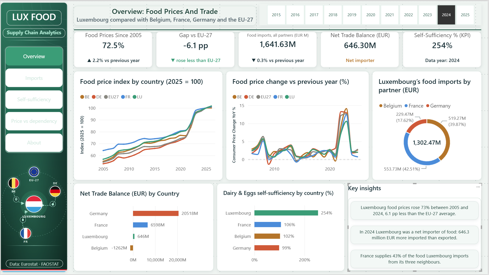
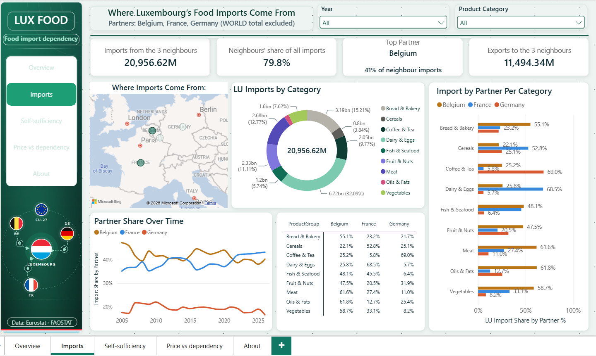
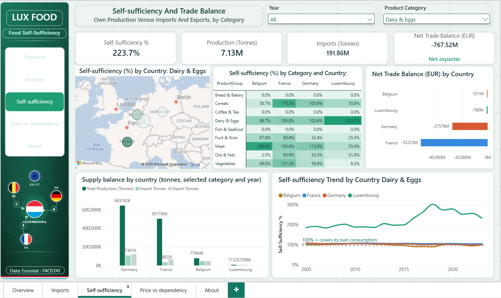
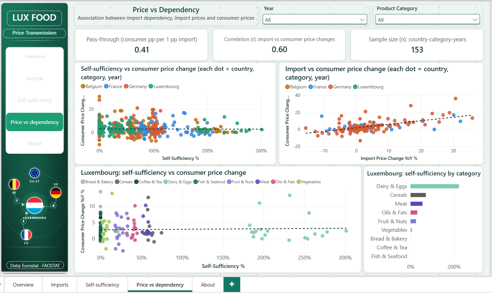
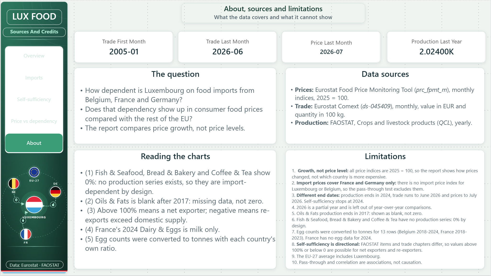
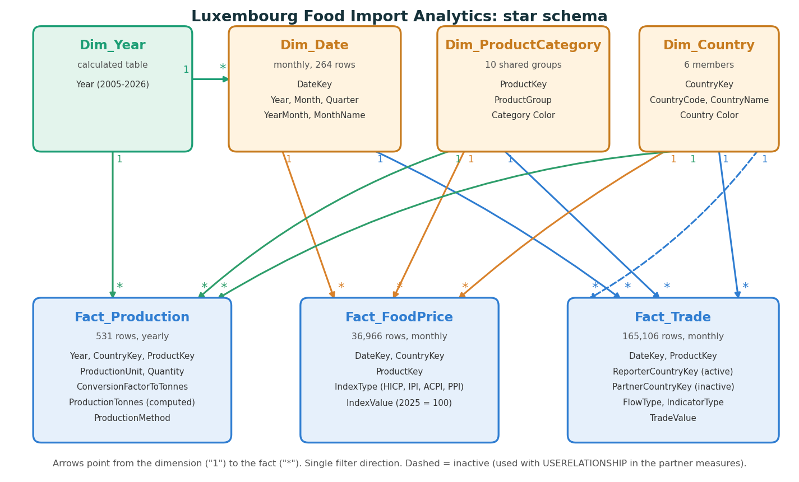

# Luxembourg & Neighbors: Food Price and Import Dependency Analytics

A SQL Server + Power BI analysis of how dependent Luxembourg is on food imports from Belgium, France and Germany, and whether that dependency shows up in food prices compared with the rest of the EU. Built from three public datasets (Eurostat prices, Eurostat Comext trade, FAOSTAT production) and modelled as a star schema.



## Main question

> How dependent is Luxembourg on food imports from Belgium, France and Germany, and does that dependency show up in higher consumer food prices compared with the rest of the EU?

## Key findings

All figures come from the dashboard and were re-computed from the model's data. Trade values are euros, production is in tonnes.

1. **The three neighbours supply about 80% of Luxembourg's food imports.** In 2025 they delivered EUR 1,416.6M of EUR 1,772.6M (79.9%). France is the largest supplier (42.9% of neighbour imports), then Belgium (38.1%) and Germany (19.0%).
2. **France dominates dairy and egg imports**: 71.3% of the Dairy & Eggs that Luxembourg imports from its neighbours in 2025 (Belgium 23.5%, Germany 5.2%). Yet Luxembourg is a *net exporter* of Dairy & Eggs (EUR 157.2M more exported than imported) and produces about 2.5 times its apparent consumption (254% self-sufficiency in 2024).
3. **Overall Luxembourg is a net food importer**: imports of EUR 1,772.6M against exports of EUR 1,060.0M in 2025 (net EUR 712.6M). The biggest import categories are Dairy & Eggs (EUR 563.5M), Bread & Bakery (EUR 254.5M) and Meat (EUR 220.4M).
4. **Self-sufficiency is low outside dairy (2024)**: Cereals 53%, Meat 51%, Vegetables 21%, Fruit & Nuts 18%. Fish & Seafood, Bread & Bakery and Coffee & Tea have no domestic production series (shown as 0% by design).
5. **Luxembourg's food prices rose less than the EU average.** Consumer food prices rose 76.0% between 2005 and 2025, 7.7 percentage points below the EU-27 (+83.7%). Belgium +81.6%, France +55.9%, Germany +88.6%.
6. **Consumer prices follow import prices only partly.** Across 153 country-category-years the pass-through slope is **0.41** (correlation 0.60): a 1 percentage point rise in import prices goes with about a 0.41 point rise in consumer prices (France 0.18 on 40 points, Germany 0.50 on 113). Import price indices exist only for France and Germany, so Luxembourg and Belgium are not in this test.
7. **Import dependency does not explain price growth in this data.** Plotting self-sufficiency against consumer price change for 602 country-category-years shows no relationship (correlation about -0.01; Luxembourg alone 0.04).

These are associations, not proof of cause. Price indices are 2025 = 100 for every country, so they show **growth, not which country is more expensive**.

## Dashboard (5 pages)

| Page | What it shows |
|---|---|
| **Overview** | KPI cards (price growth vs EU, imports, net trade balance, self-sufficiency), price index and year-over-year lines, imports by partner, key insights that update with the year |
| **Imports** | Where Luxembourg's food imports come from: map, partner share over time, category mix, partner by category |
| **Self-sufficiency** | Production vs imports and exports by country and category: map, matrix, supply balance, trend with the 100% line |
| **Price vs dependency** | Scatter plots of self-sufficiency vs price change and import vs consumer price change, with pass-through, correlation and sample size |
| **About** | The question, data sources, reading the charts, limitations |

| Imports | Self-sufficiency |
|---|---|
|  |  |
| **Price vs dependency** | **About** |
|  |  |

The Power BI file itself is not published. [`powerbi/`](powerbi/) contains the full DAX, the data model, the theme and the design assets so the report can be audited or rebuilt.

## Data and model

| Source | Dataset | Grain | Rows loaded |
|---|---|---|---|
| Eurostat Food Price Monitoring Tool | `prc_fpmt_m` | monthly price indices (2025 = 100), 2005-01 to 2026-07 | 36,966 |
| Eurostat Comext | `ds-045409` | monthly trade, value in EUR and quantity in 100 kg, 2005-01 to 2026-06 | 165,106 |
| FAOSTAT | Crops and livestock products (QCL) | yearly production, 2005 to 2024 | 531 (597 staged) |

Countries: Luxembourg (focus), Belgium, France, Germany, plus the EU-27 average as a reference. Ten product groups reconcile three classification systems (COICOP, HS chapters, FAOSTAT items) into one list.



## How it was built

1. **Power Query**: clean and key the three raw files, map every label to a short code and a shared `ProductGroup` ([steps](power_query/POWER_QUERY_STEPS.md)).
2. **SQL Server**: create the star schema, load staging tables, check duplicates, load the facts and validate row counts ([`sql`](sql)). Eight business-question queries and eight matching views.
3. **Power BI**: model, DAX measures and five pages ([`powerbi`](powerbi)).

Decisions that shape the numbers:

- **Trade totals use the partner "WORLD"**, which already is the total across partners. Adding BE, FR and DE on top would count the same goods twice.
- **Units**: trade quantity is in 100 kg and production in tonnes, so trade is divided by 10 before the two are combined.
- **Eggs are counted once.** FAOSTAT reports hen eggs in tonnes and in thousands of eggs for the same years. Every tonnes row is kept; a count row is kept only where no tonnes row exists (Belgium 2018-2024, France 2018-2023, 13 rows) and converted with that country's own tonnes-per-1,000-eggs ratio from the overlap years (Belgium 62.6 g per egg, France 60.7 g). 66 duplicate count rows are ignored. Reported and converted rows are flagged in `ProductionMethod`.
- **Self-sufficiency** = production / (production + imports - exports). It is built from sums, never from averaged ratios.
- **Price transmission** compares year-over-year changes of the import price index and the consumer price index, and the slope is calculated in DAX.

## Limitations

1. **Growth, not price level.** All indices are 2025 = 100, so the report shows how prices changed, not which country is more expensive.
2. **Import price data exists for France and Germany only.** There is no import price index for Luxembourg or Belgium (and no producer price index for Luxembourg, a sparse one for Belgium), so the pass-through test covers France (40 points) and Germany (113 points) only.
3. **Different end dates.** Production ends in 2024, trade runs to June 2026 and prices to July 2026. Self-sufficiency stops at 2024.
4. **2026 is a partial year** and is left out of year-over-year comparisons.
5. **Missing production data.** Oils & Fats production ends in 2017 (shown blank, not zero). Fish & Seafood, Bread & Bakery and Coffee & Tea have no production series and show 0% by design.
6. **Self-sufficiency is directional.** FAOSTAT items and trade chapters do not cover identical goods, so values can exceed 100% or turn negative for net exporters and re-exporters.
7. **Egg conversion is an estimate** for 13 rows. France has no egg data for 2024, so its 2024 Dairy & Eggs is milk only, and Belgium's egg series breaks between 2017 and 2018 in FAOSTAT's own data.
8. **Association, not causation.**
9. **The EU-27 average includes Luxembourg**, so it is not a "rest of the EU" benchmark.

## Repository structure

```
Luxembourg-supply-chain-food-analytics/
├── data/
│   ├── clean_data/
│   │   ├── Fact_FoodPrice.csv
│   │   ├── Fact_Production.csv
│   │   └── Fact_Trade.csv
│   └── raw_data/
│       └── README.md
├── power_query/
│   ├── POWER_QUERY_STEPS.md
├── powerbi/
│   ├── dax_measures/
│   │   └── dax_measures.md
│   ├── model/
│   │   └── star_schema.png
│   ├── screenshots/
│   │   ├── Page_1_Overview.PNG
│   │   ├── Page_2_Imports.PNG
│   │   ├── Page_3_Self-Suffiency.PNG
│   │   ├── Page_4_Price_vs_Dependency....PNG
│   │   └── Page_5_About.PNG
│   └── README.md
├── sql/
│   ├── 01_schema_and_load.sql
│   ├── 02_business_questions.sql
│   └── 03_views_for_powerbi.sql
├── .gitignore
├── LICENSE
└── README.md
```


## Tools

SQL Server (T-SQL, CTEs, window functions), Power Query (M), Power BI Desktop (DAX, data modelling, theming), Excel.

## Author

**Hakim El Azzouzi**

## Licence and data attribution

Code, SQL, DAX and documentation: [MIT License](LICENSE). The datasets are **not included**; they belong to Eurostat and FAO, whose terms of use apply. Please cite them if you reuse the data.
